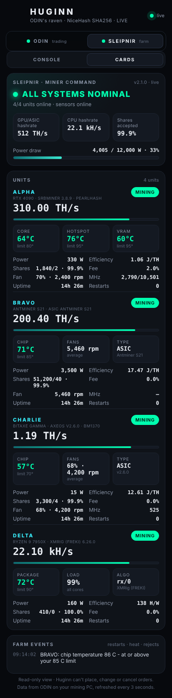

# ODIN Suite
https://asgardhashworks.github.io/odin-suite-releases/
**Your mining farm, run like a data center.** ODIN Suite: enterprise-grade control for Bitcoin mining farms.
Unified supervision, automated hashrate procurement and secure mobile oversight in one Windows platform. ODIN Suite keeps every miner online, enforces your capital limits on every NiceHash order, and puts live farm telemetry in your pocket. It deploys the same way for a home rig or a 1,000-unit site.

Engineered in Rust. Every component is written in Rust and compiled to native machine code, the same language trusted for high-performance infrastructure. Each program is a single self-contained executable, with no runtime to install and no garbage-collector pauses. Rust’s strict, memory-safe design rules out entire classes of crashes and leaks before the software ships. The result runs around the clock on a light footprint, polls hundreds of units in parallel, and reacts to the order book every two seconds.

| | What it does |
| --- | --- |
| **ODIN** | Hashrate trading engine for NiceHash (SHA256ASICBOOST). Reads the live order book, learns how the market moves, and bids only while the margin is positive. Above your break-even it parks the order and waits for a dip instead of chasing the price. |
| **SLEIPNIR** | Miner supervisor. Starts your miners, restarts any that crash, freeze or slow down, and alerts you on core, hotspot, VRAM and ASIC chip temperatures. |
| **HUGINN** | Read-only phone dashboard over a private link. Two tabs (trading and farm), with the farm shown as a console or as cards. It can't place, change or cancel anything. |
| **FREKI** | Optional: build notes for a 0% developer-fee CPU miner. |

  
  
  

Screenshots use sample data.

## Supported hardware

| Type | How SLEIPNIR talks to it | Restarts it? |
| --- | --- | --- |
| NVIDIA, AMD and Intel Arc GPUs | SRBMiner-Multi or SpinelMiner HTTP API, plus LibreHardwareMonitor sensors | Yes |
| CPUs | XMRig HTTP API, plus LibreHardwareMonitor sensors | Yes |
| Large ASICs: Antminer, Whatsminer, Avalon, Braiins OS, LuxOS | cgminer API on TCP 4028 | Watches and alerts; never power-cycles |
| Small ASICs: Bitaxe, NerdQAxe and other AxeOS devices | AxeOS HTTP API | Yes, through the device's own restart call |

All units are polled at the same time, so a farm of hundreds of units still refreshes in seconds. With more than 6 units the console switches to one line per unit.

## Quick start (Windows 10/11)

1. Download the latest `odin-suite-…-windows-x64.zip` from **Releases** and unzip it.
2. Double-click **`Install.bat`**. The wizard:
   - installs ODIN, SLEIPNIR and LibreHardwareMonitor;
   - asks for your farm size and sets starting limits (Home, Small business, Mid-size or Industrial);
   - asks for your NiceHash API key (withdrawals **off**) and your pool;
   - finds your GPUs and CPU, and adds your large and small ASICs by IP address;
   - creates a private push-alert topic, desktop shortcuts, and auto-start at login;
   - optionally sets up Tailscale so HUGINN works on your phone.
3. ODIN starts in **watch-only mode** (`DRY_RUN=1`). Watch it for a day. When you're happy, set `DRY_RUN=0` in `C:\ODIN-Suite\odin\odin.env`.

## How ODIN decides

1. Every 2 seconds it reads the public order book and rates each price level on speed, miners, volume, fill and stability.
2. It works out what 1 EH/s earns right now from live Bitcoin difficulty and block rewards, minus your pool fee, and compares that with each level's cost plus NiceHash's 3% buyer fee.
3. It locks onto a level only after it has stayed stable. How long it waits is learned from the market's own history.
4. If the market is above your profitable maximum, the **profit guard** parks your order there. You pay only for hashrate you actually receive, so a parked order costs nothing until the market dips into profit.
5. Capital protection runs throughout:
   - a hard price ceiling and step-limited raises;
   - a freeze when it detects it is chasing the price;
   - daily spend and loss kill switches;
   - order-count limits;
   - with a Kryptex pool, a check that the hashrate billed actually arrived (verified P/L).

## Safety

- **Your keys stay on your PC.** They are written to `odin.env`, which only your Windows account can read. Nothing is sent anywhere except to NiceHash's own API.
- **Use an API key with withdrawals turned off.** ODIN never needs to move coins out of your account.
- **HUGINN is read-only** and protected by a random key. Reach it from your phone through Tailscale; don't open a port to the internet.
- **Read `DISCLAIMER.md` in the download.** Trading hashrate can lose money.

## Settings

Every option is listed in `docs\CONFIGURATION.md` inside the download. The phone app is covered in `docs\HUGINN.md`.

## Professional setup and support

Want it installed and tuned for you, from a single rig to an industrial site? Remote setup packages are available: e-mail **schancellor007@gmail.com** to book one.

## Plans

ODIN Suite is free to install. Live trading is unlocked by an **ODIN Pro** subscription, which includes all updates, patches and support.

| Plan | Price (USD) | Live trading | Units in SLEIPNIR | Support |
| --- | --- | --- | --- | --- |
| Free | $0 | Watch-only, with a "what Pro would have earned" counter | Up to 5 | Community |
| Pro Home | $9 / month | 1 order, up to 5 PH/s | Up to 10 | E-mail |
| Pro Farm | $49 / month | 3 orders, up to 50 PH/s | Up to 100 | E-mail, 24 h |
| Pro Business | $249 / month | 10 orders, up to 500 PH/s | Up to 1,000 | Priority |
| Enterprise | Quoted per site | Custom | Unlimited | Response-time agreement |

**Get ODIN Pro:** e-mail **[schancellor007@gmail.com](mailto:schancellor007@gmail.com?subject=ODIN%20Pro%20order)** with the plan you want. Pro is paid in Bitcoin; your license key is e-mailed back once the payment arrives. Then activate it: run `odin.exe --activate YOUR-KEY` in `C:\ODIN-Suite\odin`, or enter the key in the installer. Set `DRY_RUN=0` in `odin.env` to start trading.

## License

ODIN Suite is proprietary software licensed under the ODIN Suite End-User License Agreement (`LICENSE` in the download). Source code is not public. Not affiliated with NiceHash, Kryptex, Bitmain, MicroBT, Canaan or the Bitaxe project.
