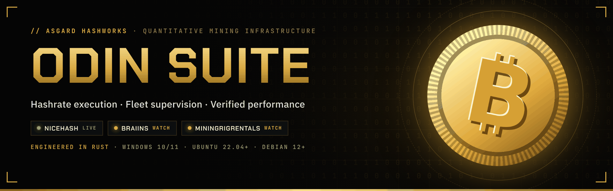
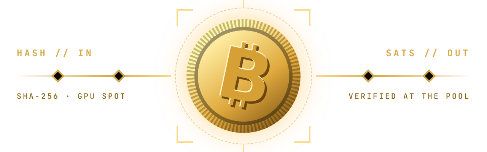
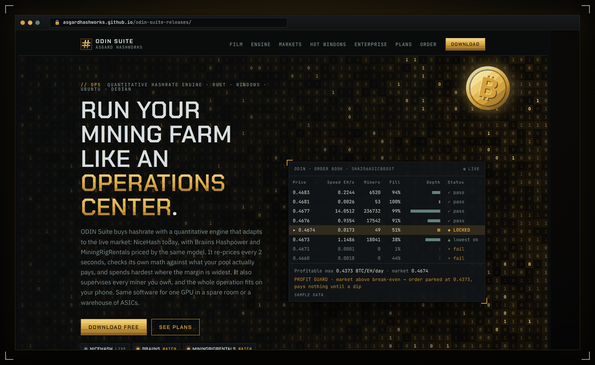
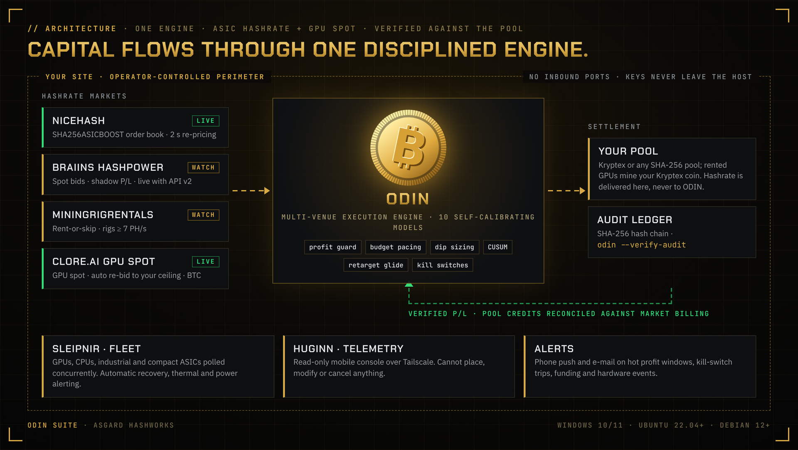
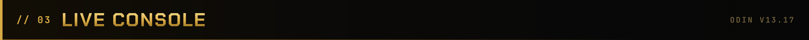
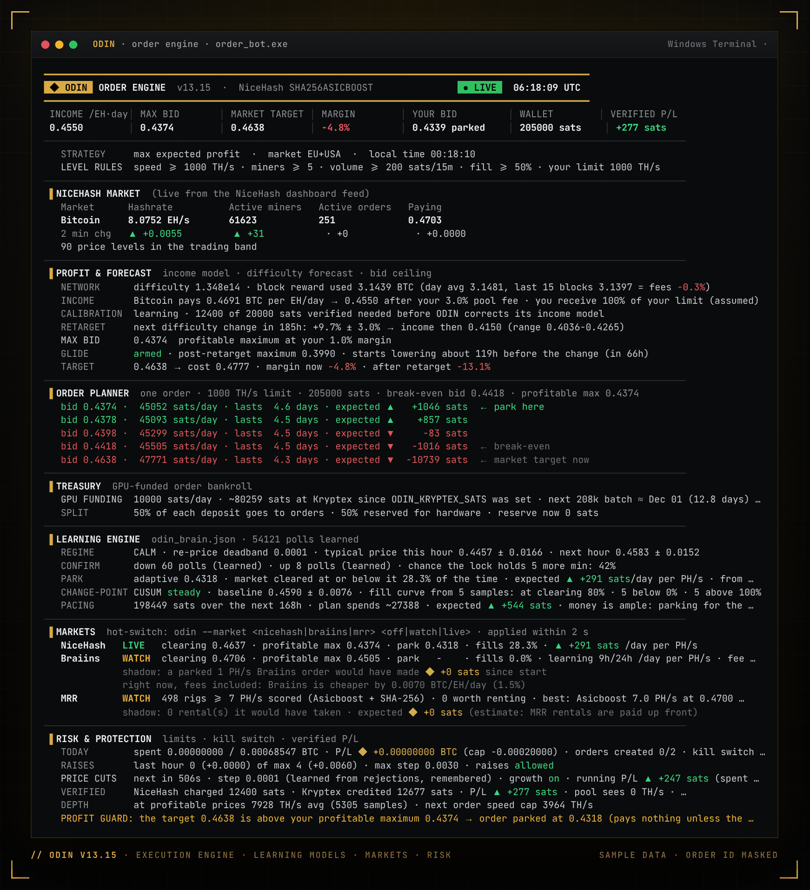
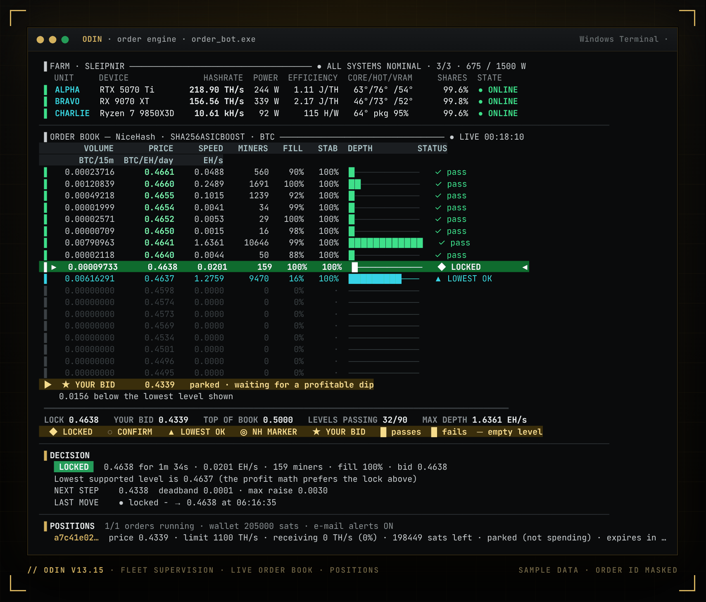
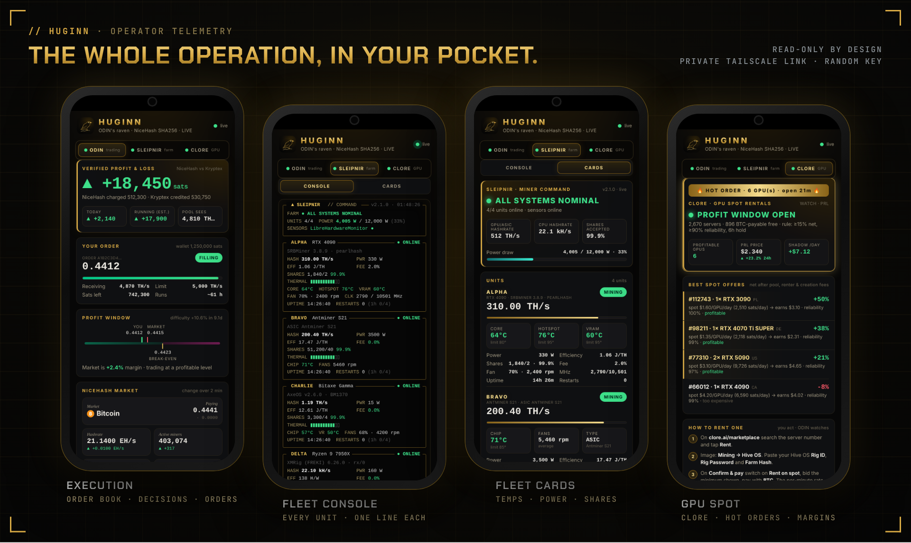
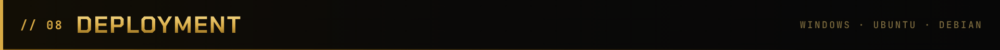

<p align="center">
  
</p>

<p align="center">
  <a href="https://github.com/asgardhashworks/odin-suite-releases/releases/latest"></a>
  
  
  
</p>

<p align="center">
  <a href="https://asgardhashworks.github.io/odin-suite-releases/"><b>WEBSITE</b></a> &nbsp;·&nbsp;
  <a href="https://github.com/asgardhashworks/odin-suite-releases/releases/latest"><b>DOWNLOAD</b></a> &nbsp;·&nbsp;
  <a href="ODIN_Suite_Enterprise_Brief.pdf"><b>ENTERPRISE BRIEF</b></a> &nbsp;·&nbsp;
  <a href="ODIN_Suite_Architecture_Security_Whitepaper.pdf"><b>SECURITY WHITEPAPER</b></a> &nbsp;·&nbsp;
  <a href="ODIN_Suite_Linux_Deployment_Guide.pdf"><b>LINUX RUNBOOK</b></a> &nbsp;·&nbsp;
  <a href="SECURITY.md"><b>SECURITY POLICY</b></a>
</p>

<p align="center"></p>


ODIN Suite is an on-premises execution platform for mining capital. Its engine, ODIN, connects to multiple compute marketplaces, normalises every venue's pricing into one unit of account (cost per day of verified output, fees and rival bids included), and commits capital only when the price clears a verified margin. The suite also supervises the physical fleet behind it and delivers read-only telemetry to the operator's phone. Every component runs inside the operator's own network: API credentials never leave it and no inbound ports are opened.

> **Operating doctrine.** Capital is committed only when the mathematics justify it, and every outcome is verified against what the pool actually pays.

| Component | Role | Function |
| --- | --- | --- |
| **ODIN** | Multi-venue execution engine | One income model, one risk layer and one audit trail across every connected venue. Re-prices every 2 seconds against live network economics; self-calibrating models decide price, size and timing; a profit guard parks capital whenever a market trades above break-even. |
| **SLEIPNIR** | Fleet supervision | Concurrent polling of GPUs, CPUs and ASICs from one rig to industrial sites. Automatic recovery; thermal and power alerting down to hotspot, VRAM and chip level. |
| **HUGINN** | Operator telemetry | Read-only mobile console over a private Tailscale link. It cannot place, modify or cancel anything, by design. |

| Operating system | Architecture | Service model | Status |
| --- | --- | --- | --- |
| Windows 10 / 11 | x86_64 | Guided installer, auto-start at login | Supported |
| Ubuntu 22.04 LTS and later | x86_64 | Sandboxed `systemd` units, dedicated no-login service account | Supported |
| Debian 12 and later | x86_64 | Sandboxed `systemd` units, dedicated no-login service account | Supported |

<p align="center"></p>


<p align="center"></p>



The execution console is a single screen: KPI strip, income model, order planner, learning engine, market router, risk limits, fleet status and the live order book.

<p align="center"></p>
<p align="center"></p>
<p align="center"><sub>ODIN v13.17 on Windows Terminal. Sample data; order identifiers masked.</sub></p>


Each venue connects through an adapter that translates its native instrument (order book, fixed-term rental or spot auction) into the engine's common cost model. Venues switch between `off`, `watch` and `live` while the engine runs; the change applies within one 2-second cycle. Profit windows on any venue raise one phone push and one e-mail per window, with a direct link to the instrument, stating whether ODIN is executing or the operator must act.

| Coverage | Algorithms and coins | Status |
| --- | --- | --- |
| SHA-256 hashrate | SHA256AsicBoost, SHA-256 | Live execution (NiceHash); watch (Braiins Hashpower, MiningRigRentals) |
| GPU compute | Pearl or any coin Kryptex prices per GPU model; `AUTO` picks each card's best coin | **Live** — order guard, auto re-bid and auto-stop (Clore.ai) |
| Further algorithms | Scrypt, KawPow, kHeavyHash and others on NiceHash | Roadmap: same adapters, coin-revenue income model |

| Venue | Instrument | Mode | Notes |
| --- | --- | --- | --- |
| **NiceHash** | SHA256ASICBOOST order book | **Live** | Full execution: lock, park, budget pacing, dip sizing, kill switches. |
| **Braiins Hashpower** | Spot bids, BTC/EH/day | Watch | Learns its own fill curve and keeps a shadow P/L. Live execution follows Braiins API v2 access. |
| **MiningRigRentals** | Fixed-term rentals, SHA256 Asicboost and SHA-256 | Watch | Rent-or-skip engine: scores every rig ≥ 7 PH/s on delivered hashrate, post-retarget price and fundable hours. |
| **Clore.ai** | GPU spot rentals, paid in BTC | **Live** | Values every bitcoin-payable GPU at live Kryptex rates (Pearl, any coin, or each card's best), net of pool, renter and creation fees, start-up time and host power limits, then re-prices each candidate at the bid that would win its live auction. Hot-order alerts carry a direct server link, the winning bid and sats per day. Rented orders are guarded: ODIN re-bids 1% over any rival up to a profit ceiling and an absolute sats/day cap, steps back down while winning, and stops a rental that runs unprofitable for 10 minutes. |


Ten models, one decision every 2 seconds.

| Model | Method |
| --- | --- |
| Hashvalue | Income per EH/s from live difficulty and actual block rewards, net of pool and buyer fees. |
| Self-calibration | Pool credits regressed against model income after a measured payout delay. |
| Retarget forecast | Next difficulty change with a standard deviation from block-arrival statistics; the bid ceiling glides ahead of it. |
| Budget pacing | Park price solved for available capital and horizon by Lagrangian duality, with hour-of-day fill rates. |
| Dip sizing | Order speed scales with margin only once it clears the model's own error band. |
| Change-point detection | Two-sided CUSUM on the clearing price; stale history is down-weighted on a regime shift. |
| Fill curve | Isotonic regression of served share versus distance from the clearing price. |
| Competitive bid pricing | Auction venues are valued at the best rival bid plus the venue's minimum increment, never at the listed floor; unverified prices cannot raise an alert. |
| GPU valuation | Each rented card is valued per coin from measured hashrate and power, derated for host power limits, net of pool and venue fees. |
| Walk-forward validation | `odin --optimize` replays recorded markets with no look-ahead; a setting is adopted only if it wins out of sample. |


**Risk controls**

- Hard price ceiling, step-limited raises and chase detection.
- Daily spend and daily loss kill switches; a tripped switch survives restarts until cleared by the operator.
- Order-count and exposure limits per licence tier.
- Verified P/L: hashrate billed by the market is reconciled against what the pool credits.
- Every installation starts in watch-only mode (`DRY_RUN=1`). Nothing trades until the operator enables it.

**Security posture**

| Control | Implementation |
| --- | --- |
| Key custody | Credentials stay on the host, encrypted at rest: DPAPI on Windows, TPM2-sealed systemd credentials on Linux. Withdrawal permission is never required and should stay off. |
| Least privilege | Linux services run as a no-login account with `ProtectSystem=strict`, `NoNewPrivileges`, `MemoryDenyWriteExecute` and an empty capability set. |
| Network exposure | Outbound HTTPS to a short published host list. No listening ports; HUGINN binds to loopback and is published only through Tailscale. |
| Audit trail | Every decision is appended to `odin_audit.jsonl` as a SHA-256 hash chain. `odin --verify-audit` detects any edited, deleted or reordered entry; the JSON lines feed Loki, Splunk or Elastic. |
| Secrets at rest | API keys, secrets and passwords sealed with Windows DPAPI on first start, bound to the operator's account; owner-only file on Linux. |
| Licensing | Ed25519-signed offline licence files, machine-bound or site-wide, verified locally. Air-gapped sites never contact a licence server. |
| Supply chain | Binaries are built by GitHub Actions from tagged source. Every release ships `SHA256SUMS.txt`; the Linux installer refuses a mismatch. |

Vulnerability reports: [SECURITY.md](SECURITY.md) · Support channels and response targets: [SUPPORT.md](SUPPORT.md)


<p align="center"></p>



**Linux (Ubuntu 22.04+ / Debian 12+)**

```bash
tar -xzf odin-suite-v1.4.0-linux-x64.tar.gz && cd odin-suite
sudo ./install.sh                 # verifies checksums, creates the service account and systemd units
sudo journalctl -u odin -f -o cat # follow the engine
odin --verify-audit /var/lib/odin-suite/odin/odin_audit.jsonl
```

The [Linux Deployment & Hardening Guide](ODIN_Suite_Linux_Deployment_Guide.pdf) documents the file layout, unit hardening, network segmentation and the 30-day pilot runbook.

**Windows 10 / 11**

1. Download `odin-suite-…-windows-x64.zip` from [Releases](https://github.com/asgardhashworks/odin-suite-releases/releases/latest) and extract it.
2. Run **`Install.bat`**. The wizard installs ODIN, SLEIPNIR and LibreHardwareMonitor; sets starting limits for the site size; registers the NiceHash key (withdrawals off) and pool; discovers GPUs, CPUs and ASICs; and configures push alerts, auto-start and optional Tailscale access.
3. Operate in watch-only mode for at least one day, then set `DRY_RUN=0` in `C:\ODIN-Suite\odin\odin.env`.

**Supported hardware**

| Class | Interface | Recovery |
| --- | --- | --- |
| NVIDIA, AMD and Intel Arc GPUs | SRBMiner-Multi or SpinelMiner API; LibreHardwareMonitor and HWiNFO sensors | Automatic restart |
| CPUs | XMRig API; system sensors | Automatic restart |
| Industrial ASICs: Antminer, Whatsminer, Avalon, Braiins OS, LuxOS | cgminer API, TCP 4028 | Monitor and alert; never power-cycled |
| Compact ASICs: Bitaxe, NerdQAxe and other AxeOS devices | AxeOS HTTP API | Device restart call |

**Documentation**

| Document | Audience |
| --- | --- |
| [Enterprise Brief](ODIN_Suite_Enterprise_Brief.pdf) · 2 pages | Executives, procurement |
| [Architecture & Security Whitepaper](ODIN_Suite_Architecture_Security_Whitepaper.pdf) · 4 pages | Engineering, security review |
| [Linux Deployment & Hardening Guide](ODIN_Suite_Linux_Deployment_Guide.pdf) · 3 pages | Site operations, systems administration |
| `docs/CONFIGURATION.md`, `docs/MARKETS.md`, `docs/ENTERPRISE.md`, `docs/HUGINN.md` | Included in every release package |


ODIN Suite is free to install and evaluate. Live execution is enabled by an ODIN Pro licence, which includes all updates, patches and support.

| Tier | Price (USD) | Execution | Fleet units | Support |
| --- | --- | --- | --- | --- |
| Free | $0 | Watch-only, with a "what Pro would have earned" counter | Up to 5 | Community |
| Pro Home | $9 / month | 1 order · up to 5 PH/s | Up to 10 | E-mail |
| Pro Farm | $49 / month | 3 orders · up to 50 PH/s | Up to 100 | E-mail, 24 h |
| Pro Business | $249 / month | 10 orders · up to 500 PH/s | Up to 1,000 | Priority |
| Enterprise | Quoted per site | 50 orders · multi-EH/s · offline licence | Unlimited | Response-time agreement · 30-day paid pilot |

Enterprise structures (annual site licence, base plus performance, perpetual binary) and the 30-day commercial pilot are detailed in the [Enterprise Brief](ODIN_Suite_Enterprise_Brief.pdf).

**Procurement:** e-mail [schancellor007@gmail.com](mailto:schancellor007@gmail.com?subject=ODIN%20Suite%20licence) with the tier and site size. Licences are paid in Bitcoin; the key is issued by e-mail after one confirmation and activated with `odin --activate KEY` or in the installer.

---

## Built by an operator

ODIN Suite is engineered by **Steve Chancellor**, a former **U.S. Navy Operations Specialist**, **Search and Rescue swimmer** and **VBSS** (Visit, Board, Search and Seizure) team member. It runs on the same three rules: **own the picture** (read every market before committing a sat), **verify, then trust** (reconcile every order against what the pool credited) and **protect the mission** (kill switches, spend caps and auto-stops come first).

<sub>ODIN Suite is proprietary software licensed under the ODIN Suite End-User License Agreement (`LICENSE`, included in every release). Source code is not public. Trading hashrate involves risk of loss; ODIN Suite is infrastructure software and not financial advice. Not affiliated with NiceHash, Braiins, MiningRigRentals, Clore.ai, Kryptex, Bitmain, MicroBT, Canaan or the Bitaxe project.</sub>

<p align="center"><sub><b>ASGARD HASHWORKS</b> · Oklahoma, USA · © 2026</sub></p>
