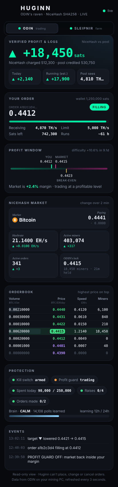
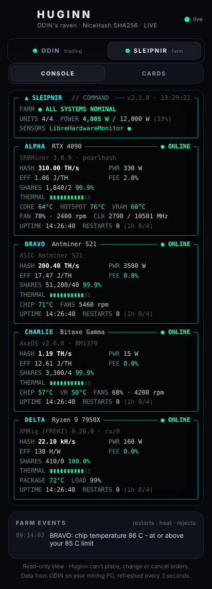

# ODIN Suite

**A self-learning quantitative engine for hashrate, and the supervisor for the farm behind it.** Native Rust · Windows 10/11 and Linux x86_64 · runs on your own hardware, with your keys never leaving it.

**Your mining farm, run like a data center.** ODIN Suite supervises every miner you own, buys NiceHash hashrate only when it pays, and puts the whole operation on your phone. It works the same for one GPU in a spare room and for a warehouse of ASICs.

| | What it does |
| --- | --- |
| **ODIN** | Hashrate trading engine for NiceHash (SHA256ASICBOOST). Reads the live order book, learns how the market moves, and bids only while the margin is positive. Above your break-even it parks the order and waits for a dip instead of chasing the price. |
| **SLEIPNIR** | Miner supervisor. Starts your miners, restarts any that crash, freeze or slow down, and alerts you on core, hotspot, VRAM and ASIC chip temperatures. |
| **HUGINN** | Read-only phone dashboard over a private link. Two tabs (trading and farm), with the farm shown as a console or as cards. It can't place, change or cancel anything. |
| **FREKI** | Optional: build notes for a 0% developer-fee CPU miner. |

<p align="center">
  
  
  
</p>
<p align="center"><sub>Screenshots use sample data.</sub></p>

## Markets

NiceHash today, plus **Braiins Hashpower** in watch mode: ODIN learns that market alongside NiceHash, compares them fees included, and tells you where new money earns more. Switch any market on, off or live while ODIN runs with `odin --market braiins watch`. See `docs/MARKETS.md` in the download.

## Supported hardware

| Type | How SLEIPNIR talks to it | Restarts it? |
| --- | --- | --- |
| NVIDIA, AMD and Intel Arc GPUs | SRBMiner-Multi or SpinelMiner HTTP API, plus LibreHardwareMonitor sensors | Yes |
| CPUs | XMRig HTTP API, plus LibreHardwareMonitor sensors | Yes |
| Large ASICs: Antminer, Whatsminer, Avalon, Braiins OS, LuxOS | cgminer API on TCP 4028 | Watches and alerts; never power-cycles |
| Small ASICs: Bitaxe, NerdQAxe and other AxeOS devices | AxeOS HTTP API | Yes, through the device's own restart call |

All units are polled at the same time, so a farm of hundreds of units still refreshes in seconds. With more than 6 units the console switches to one line per unit.

## Quick start (Linux x86_64)

```bash
tar -xzf odin-suite-v1.4.0-linux-x64.tar.gz && cd odin-suite
sudo ./install.sh          # verifies checksums, creates the odin service account and systemd services
sudo journalctl -u odin -f -o cat
```

See the [Linux Deployment Guide](ODIN_Suite_Linux_Deployment_Guide.pdf) for the file layout, sandboxing and network list.

## Quick start (Windows 10/11)

1. Download the latest `odin-suite-…-windows-x64.zip` from **Releases** and unzip it.
2. Double-click **`Install.bat`**. The wizard:
   - installs ODIN, SLEIPNIR and LibreHardwareMonitor;
   - asks for your farm size and sets starting limits (Home, Small business, Mid-size or Industrial);
   - asks for your NiceHash API key (withdrawals **off**) and your pool;
   - finds your GPUs and CPU, and adds your large and small ASICs by IP address;
   - creates a private push-alert topic, desktop shortcuts, and auto-start at login;
   - optionally sets up Tailscale so HUGINN works on your phone.
3. ODIN starts in **watch-only mode** (`DRY_RUN=1`). Watch it for a day. When you're happy, set `DRY_RUN=0` in `C:\ODIN-Suite\odin\odin.env`.

## How ODIN decides

Every 2 seconds ODIN reads the public order book. Every decision is re-derived from live data and from what ODIN has learned on your own account.

**Pricing the hash**
- **Live hashvalue.** Income per EH/s comes from current difficulty and the actual block rewards, fees included, net of your pool fee.
- **Self-calibration.** Your pool's real credits are compared with the model's prediction, after the payout delay that ODIN measures itself. The income model is then corrected.
- **Difficulty forecast with an error range.** The next retarget is projected with a standard deviation derived from block-arrival statistics. The bid ceiling glides down ahead of the change, because NiceHash only lets prices fall slowly.

**Choosing the price**
- **Level lock.** ODIN commits to a price level only after it has held. The wait is learned from the market's own survival times.
- **Profit guard.** Above break-even the order parks at your profitable maximum. A parked order costs nothing until the market dips into it.
- **Budget pacing.** The park price is solved for the money you actually have and how long it must last, using Lagrangian duality on the expected-value model. Hour-of-day fill rates are included.
- **Spend into the dip.** Speed limits are free to change, so speed rises only when the margin clears the model's own error band. The budget is therefore spent where the margin is widest.
- **Change-point detection.** A two-sided CUSUM watches the clearing price for level shifts. Stale history is down-weighted the moment the market moves.
- **Partial-fill curve.** ODIN learns how much of its limit is really served at each distance from the clearing price. It uses isotonic regression, so a higher bid never "fills less".

**Testing and protection**
- **Walk-forward tuning.** `--optimize` replays your own recordings with no look-ahead and NiceHash's price-cut limits applied. It adopts a setting only if it wins in both halves of the history.
- **Capital protection** runs throughout:
  - a hard price ceiling and step-limited raises;
  - a freeze when ODIN detects it is chasing the price;
  - daily spend and loss kill switches;
  - order-count limits;
  - with a Kryptex pool, a check that the hashrate billed actually arrived (verified P/L).

## Safety

- **Your keys stay on your machine.** They live in `odin.env`, readable only by your Windows account (on Linux: root-only, injected by systemd). They are only ever sent to NiceHash's own API. The full outbound list is in the [whitepaper](ODIN_Suite_Architecture_Security_Whitepaper.pdf).
- **Tamper-evident audit ledger.** Every event and decision is written to `odin_audit.jsonl` as a SHA-256 hash chain; `odin --verify-audit` proves it hasn't been edited.
- **Offline licences for air-gapped sites.** These are Ed25519-signed licence files, machine-bound or site-wide, checked locally. See `docs/ENTERPRISE.md` in the download.
- **Verify what you run.** Every release ships `SHA256SUMS.txt`; binaries are built by GitHub Actions from the tagged source.
- **Use an API key with withdrawals turned off.** ODIN never needs to move coins out of your account.
- **HUGINN is read-only** and protected by a random key. Reach it from your phone through Tailscale; don't open a port to the internet.
- **Read `DISCLAIMER.md` in the download.** Trading hashrate can lose money.

## Settings

Every option is listed in `docs/CONFIGURATION.md` inside the download. The phone app is covered in `docs/HUGINN.md`.

## Enterprise

- [Enterprise Brief (PDF)](ODIN_Suite_Enterprise_Brief.pdf)
- [Architecture & Security Whitepaper (PDF)](ODIN_Suite_Architecture_Security_Whitepaper.pdf)
- [Linux Deployment & Hardening Guide (PDF)](ODIN_Suite_Linux_Deployment_Guide.pdf)

## Professional setup and support

Want it installed and tuned for you, from a single rig to an industrial site? Remote setup packages are available: e-mail **schancellor007@gmail.com** to book one.

## Plans

ODIN Suite is free to install. Live trading is unlocked by an **ODIN Pro** subscription, which includes all updates, patches and support.

| Plan | Price (USD) | Live trading | Units in SLEIPNIR | Support |
| --- | --- | --- | --- | --- |
| Free | $0 | Watch-only, with a "what Pro would have earned" counter | Up to 5 | Community |
| Pro Home | $9 / month | 1 order, up to 5 PH/s | Up to 10 | E-mail |
| Pro Farm | $49 / month | 3 orders, up to 50 PH/s | Up to 100 | E-mail, 24 h |
| Pro Business | $249 / month | 10 orders, up to 500 PH/s | Up to 1,000 | Priority |
| Enterprise | Quoted per site | 50 orders, multi-EH/s, offline licence | Unlimited | Response-time agreement, paid pilot available |

**Get ODIN Pro:** e-mail **[schancellor007@gmail.com](mailto:schancellor007@gmail.com?subject=ODIN%20Pro%20order)** with the plan you want. Pro is paid in Bitcoin; your license key is e-mailed back once the payment arrives. Then activate it: run `odin.exe --activate YOUR-KEY` in `C:\ODIN-Suite\odin`, or enter the key in the installer. Set `DRY_RUN=0` in `odin.env` to start trading.

## License

ODIN Suite is proprietary software licensed under the ODIN Suite End-User License Agreement (`LICENSE` in the download). Source code is not public. Not affiliated with NiceHash, Kryptex, Bitmain, MicroBT, Canaan or the Bitaxe project.
